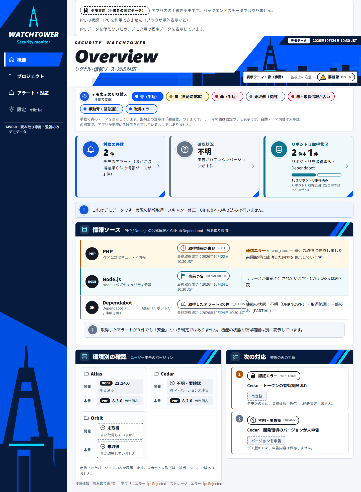
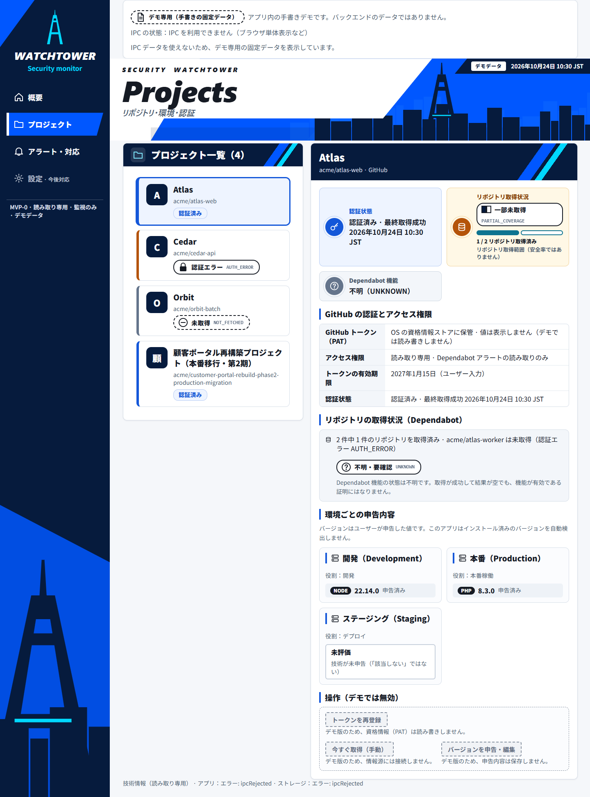
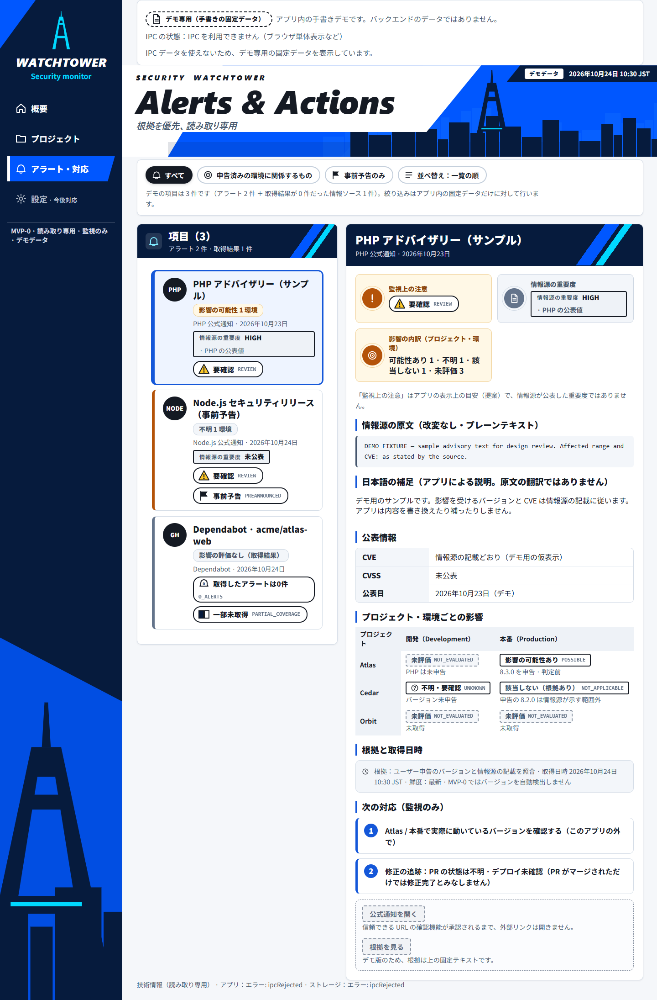

# Security Watchtower

## 複数の開発プロジェクトのセキュリティ情報を、一か所で把握する。

Security Watchtower は、個人開発者・小規模チーム向けの **ローカルファースト** なセキュリティ情報監視アプリです（Windows デスクトップアプリとして開発中）。

- **PHP / Node.js の公式セキュリティ情報**
- **GitHub Dependabot アラート**（読み取り専用）
- **プロジェクト・環境（開発／本番など）ごとに申告したバージョン**

これらを 1 つの画面にまとめ、「どの環境に関係しそうか」「何が分かっていて、何が分かっていないか」「次に何を確認すべきか」を示します。
データと GitHub のトークンは、外部のサービスではなく手元の PC で扱う設計です。

> **「アラートが 0 件」と「安全である」は違う。**
>
> 取得していない、権限が足りない、機能の状態が分からない――そうした「情報の不足」を、このアプリは「問題なし」として表示しません。
> 0 件・未取得・権限不足・不明を、それぞれ別の状態として示すことを設計の中心にしています。

> **ご注意**
> - このリポジトリは **作品紹介（Showcase）** です。ソースコードは含まれていません。
> - 開発中のプロジェクトです。配布版（Windows Public Beta）は未公開です。
> - 下の画像はすべて **ブラウザプレビュー／デモデータ（合成）／Tauri IPC未使用** です。Windows アプリとしての動作結果や、外部サービスからの実取得結果ではありません。
> - 正式な受け入れ基準（MVP-0 Acceptance）は **0 / 8 PASS** です。
> - 詳しい検証状況は、このページ後半の「[実装と実測の区別](#8-実装と実測の区別)」と [KNOWN_LIMITATIONS.md](KNOWN_LIMITATIONS.md) に記載しています。

---

## スクリーンショット

### Overview（概要）


*Overview — ブラウザプレビュー／デモデータ（合成）／Tauri IPC未使用*

### Projects（プロジェクト）


*Projects — ブラウザプレビュー／デモデータ（合成）／Tauri IPC未使用*

### Alerts & Actions（アラート・対応）


*Alerts & Actions — ブラウザプレビュー／デモデータ（合成）／Tauri IPC未使用*

**画像について**

- アプリのフロントエンド（React）を、開発用サーバー（自分の PC 内のループバックのみ）でブラウザに表示して撮影しました。
- 表示しているのは、アプリに組み込まれた **手書きの固定デモデータ** です。プロジェクト名（Atlas / Cedar / Orbit など）、リポジトリ名（`acme/*`）、日時、件数、アドバイザリーの内容はすべて架空です。
- デスクトップアプリのバックエンド（Tauri IPC）を使っていないため、画面下部の技術情報に `ipcRejected` と表示されています。これは想定どおりの表示です。
- **Windows デスクトップアプリの動作確認結果や、GitHub・公式サイトからの実取得結果ではありません。**

---

## 1. 解決したい問題

- **情報が散らばっている。** 公式のセキュリティ告知、Dependabot アラート、自分のプロジェクトで動いているバージョンを、それぞれ別の場所で確認する必要があります。
- **「0 件」が「安全」に見えてしまう。** アラート 0 件と、未取得・権限不足・機能の状態が不明は、意味がまったく違います。それでも、同じように「問題なし」と見えてしまいがちです。
- **秘密情報を外に出したくない。** GitHub のトークンや取得したデータを、手元の PC だけで扱いたいという要望があります。

## 2. 対象ユーザー

- PHP / Node.js を使ったプロジェクトを複数運用している個人開発者
- 専任のセキュリティ担当がいない小規模チーム
- セキュリティ情報の確認を、手元の PC で完結させたい人

最初の段階（MVP-0）は **監視専用・読み取り専用** に範囲を絞っています。脆弱性スキャンの実行、コードの自動修正、GitHub への書き込み、デプロイは行いません。

## 3. 3つの画面

| 画面 | 内容 |
|---|---|
| **Overview** | 情報ソース（PHP / Node.js / Dependabot）ごとの取得状況、対象件数、環境別の申告バージョン、次に行う対応。「取得情報が古い」「事前予告」「アラート 0 件（ただし取得範囲は一部のみ）」のように、状態と根拠を分けて表示します。 |
| **Projects** | プロジェクトごとのリポジトリ、環境と申告バージョン、GitHub の認証状態、Dependabot の取得範囲。バージョンはユーザーが申告した値で、アプリが自動検出するものではないことも画面に明記しています。 |
| **Alerts & Actions** | 公式情報と Dependabot アラートの一覧。情報源の原文（改変なし）、アプリによる日本語の補足（翻訳ではない）、公表情報、プロジェクト・環境ごとの影響の目安、根拠と取得日時、次の対応を表示します。「監視上の注意」はアプリの表示上の目安で、情報源が公表した重要度とは区別しています。 |

## 4. 技術スタック

| 領域 | 技術 |
|---|---|
| デスクトップ | Tauri 2（Windows 優先。macOS への移植は後続工程） |
| コア | Rust（ドメインモデル、Provider、ストレージ、スキーマ移行） |
| UI | React / TypeScript / Vite |
| データ | SQLite（ローカル保存） |
| 資格情報 | OS ネイティブの資格情報ストア（Windows 資格情報マネージャー） |
| 通信 | Rust 側の HTTPS クライアント（固定 URL への GET のみ） |

## 5. アーキテクチャ

```
┌──────────────────────────── WebView（React / TypeScript）────────────────────────────┐
│  Overview / Projects / Alerts & Actions                                                │
│  型付き IPC クライアント（決められたコマンドのみ。URL・トークン・SQL は扱わない）       │
└──────────────────────────────────────┬─────────────────────────────────────────────────┘
                                       │ Tauri IPC（許可したコマンドだけを capability で列挙）
┌──────────────────────────────────────┴──── Tauri ホスト（Rust）──────────────────────────┐
│  IPC コマンド層：入力の検証、応答の整形（エラーは決められたコードのみ）                  │
│  Adapter 層（差し替え可能）                                                             │
│    ・公式フィードの取得：固定 URL に HTTPS GET（本番用 / 通信しない E2E・テスト用）     │
│    ・GitHub Dependabot の取得：登録済みリポジトリのみ（本番用 / 通信しない E2E・テスト用）│
│    ・資格情報ストア：OS の資格情報ストア（本番用 / 読み書きしない E2E・テスト用）       │
└──────────────────────────────────────┬─────────────────────────────────────────────────┘
┌──────────────────────────────────────┴──── Rust コア ───────────────────────────────────┐
│  Provider：PHP 公式 / Node.js 公式 / PHP ニュース / GitHub Dependabot                   │
│    取得した文書の検証（サイズ上限、XML・JSON の事前検査、重複キーの拒否など）→ 正規化   │
│  ドメイン：段階（事前予告・公表済み・未分類）、影響の目安、取得範囲、鮮度、根拠          │
│  ストレージ：SQLite（スキーマ移行、データ由来の記録、管理フォルダーの所有者検査）       │
└──────────────────────────────────────────────────────────────────────────────────────────┘
```

- **Provider** は、情報源ごとの文書を検証・解析し、共通のドメインの型に変換します。分類は Provider ではなくコアのルールで行います。
- **Adapter** は、通信・資格情報ストアなど OS や外部に触れる部分です。トレイト（インターフェース）で抽象化し、本番用と、通信しないテスト・E2E 用の実装を差し替えられるようにしています。
- UI は IPC の決められたコマンドだけを呼び、ネットワーク・資格情報・データベースには直接触れません。

## 6. セキュリティ設計上の工夫

以下は **設計と実装、および自動テスト（fixture / mock）で確認している内容** です。実際の Windows 環境での安全性を保証するものではありません。実測の状況は次の章に分けて記載しています。

- **最小権限の IPC：** Tauri のプラグイン、シェル、ファイルアクセスを使っていません。型付きの固定コマンドだけを、capability で明示的に許可しています。
- **厳格な CSP：** アプリのページ（UI のコンテンツ）から外部への接続を許可していません（接続先は IPC のみ）。※ CSP が制限するのはページの内容であり、WebView2 ランタイム自体の通信は対象外です（下記「通信の扱い」）。
- **取得先を固定：** アプリのコードが取得するのは、決められた公式フィードと GitHub API の URL だけです。UI から URL やヘッダーを指定することはできません。
- **取得文書の検証：** サイズの上限、XML・JSON の事前検査、重複キーの拒否などを行います。問題のある項目はその項目だけを拒否し、拒否した件数を「取得範囲の欠け」として表示します。
- **データ由来の明示：** 実取得データと合成データを区別して保存し、画面にバッジで表示します。
- **「不明」を「安全」にしない：** 取得 0 件、未取得、権限不足、機能の状態が不明を、それぞれ別の状態として表示します。
- **ストレージの保護：** 管理フォルダーの所有者、リパースポイント、副ファイルを検査します。古いスキーマのデータベースは、自動変換せずに起動を拒否します。

### GitHub トークン（PAT）の扱い

- **設計・実装：** トークンは OS の資格情報ストア（Windows 資格情報マネージャー）にだけ保存します。WebView・IPC・SQLite・ログを経由させない設計で、登録・置換・削除は WebView ではなくネイティブのダイアログで行います。
- **実測していないこと：**
  - 実際の PAT を使った登録・置換・削除
  - OS の資格情報ストアへの実際の書き込み（ネイティブ資格情報の実書込み）
  - GitHub Dependabot アラートの実取得（GitHub への実通信）

  いずれも mock を使った自動テストと、ビルドが通ることの確認までです。これらの安全性は、実環境ではまだ確認していません。

### 通信の扱い（アプリのコードと WebView2 ランタイムの区別）

通信には、性質の異なる 2 つの経路があります。

| 経路 | 内容 | 状態 |
|---|---|---|
| **アプリのコードによる通信**（Provider の取得処理） | 公式フィードと GitHub API への HTTPS GET。開発用の E2E ビルドでは、取得処理を **通信しない実装（NoNetwork など）** に差し替え、資格情報ストアも読み書きしない実装にしています。定期取得も起動しません。 | 実装済み・自動テストで確認 |
| **WebView2 ランタイム自体の通信** | 画面を表示する Microsoft Edge WebView2 ランタイムが、アプリのコードとは別に行う通信。過去の実行で、外部への TLS 接続を観測しています（接続先・内容・目的は未特定）。 | **未解決（D1：OPEN）** |

- E2E ビルドの「通信しない実装」は、**アプリのコードによる通信** を対象にしたものです。WebView2 ランタイム自体の通信を遮断するものではありません。
- WebView2 ランタイムの通信を抑止する方法と、その効果の検証は **未完了** です。外部通信の遮断が実証されたわけではありません。
- E2E ビルドでは、WebView2 のユーザーデータを隔離フォルダーに置く実装もしています。ただし、Windows 上での実測はまだです。リリースビルドでは、この E2E 用の機能を有効にできません（コンパイル時に拒否）。

## 7. 用語の説明

開発の管理に使っている ID を、このページでもそのまま使っています。

| 用語 | 説明 |
|---|---|
| **MVP-0** | 最初の段階の製品範囲（監視専用・読み取り専用） |
| **MVP-0 Acceptance 0 / 8** | 正式に定めた 8 つの受け入れ基準（Gate）のうち、PASS したものがまだ無い状態 |
| **Acceptance K** | Trust／信頼境界の検証。悪意ある外部データや不許可の IPC 操作によって、任意コマンド実行・不正な外部通信・認証情報の漏洩が起きないことを確認する受け入れ試験。現在は **NOT_JUDGED（未判定）** |
| **D1** | WebView2 ランタイムの外部通信に関する未解決事項。現在 **OPEN** |
| **R2** | 公式セキュリティ情報の根拠・真正性の確認に関する未解決事項。現在 **OPEN** |
| **E2E** | アプリを実際に起動し、画面操作から保存までを通して確かめるテスト |
| **fixture / mock** | テスト用に用意した固定データ・代替の実装（実際の通信や資格情報は使わない） |

## 8. 実装と実測の区別

| 機能 | 実装 | 自動テスト（fixture / mock） | 実機での確認 |
|---|---|---|---|
| 3画面の UI | あり | あり | 現在のソースは **ブラウザプレビュー（デモデータ）のみ**。Windows アプリとしての表示は過去のビルドで確認 |
| プロジェクト・環境の登録 | あり | あり | 過去のビルドで、隔離した Windows ユーザーで GUI 操作を確認（現在のソースでは未実測） |
| PHP / Node.js 公式情報の取得 | あり | あり | 過去のビルドで、各情報源への実取得を確認（現在のソースでは未実測） |
| GitHub Dependabot アラートの取得 | あり | あり（mock） | **未実測**（GitHub への実通信なし） |
| GitHub トークンの登録・置換・削除 | あり | あり（mock） | **未実測**（実 PAT の使用、資格情報ストアへの実書き込みなし） |
| E2E ビルドでのアプリ側通信の無効化 | あり | あり | Windows ホストでの GUI E2E は **未実測** |
| WebView2 ランタイム自体の通信の抑止 | **なし** | — | **未解決（D1：OPEN）** |
| E2E ビルドでの WebView2 ユーザーデータの隔離 | あり | あり | **未実測** |
| SQLite（スキーマ v6） | あり | あり | 隔離した合成データで確認 |
| OS 通知 | なし（判定用のロジックのみ） | 一部 | — |
| 設定画面 | なし（画面上も「今後対応」） | — | — |
| Windows 配布パッケージ | なし | — | — |

「過去のビルドで確認」は、開発途中の時点の作業記録に基づく限定的な確認です。現在のソースで改めて確認したものではなく、正式な受け入れ判定でもありません。

## 9. 開発状況

- 正式な MVP-0 Acceptance：**0 / 8 PASS**（8 つの受け入れ基準のうち、PASS はまだ無し）
- Acceptance K（Trust／信頼境界の検証）：**NOT_JUDGED**
- D1（WebView2 ランタイムの外部通信）・R2（公式情報の根拠・真正性）：**OPEN**
- Windows のみで開発・テストしています。macOS・Linux は未対応・未実測です。
- 配布版（Windows Public Beta）は未公開です。インストーラー、コード署名、正式なアイコンはまだありません。
- ソースコードは現時点では公開していません。

## 10. 既知の制限事項と今後の計画

### 主な制限事項
- Windows ホストでの GUI E2E は、現在のソースでは未実測です。
- 実 PAT による登録・置換・削除、資格情報ストアへの実書き込み、Dependabot の実取得は未実測です。
- WebView2 ランタイム自体の外部通信（D1）と、公式情報の根拠・真正性（R2）は未解決です。
- スキーマ v5 以前の既存データベースは移行に対応していません（新規作成のみ）。

全体は [KNOWN_LIMITATIONS.md](KNOWN_LIMITATIONS.md) を参照してください。

### 今後の計画
1. WebView2 の通信を制御したうえで、Windows ホストでのオンライン GUI 検証（E2E 用ビルドのみ）
2. GitHub トークンと Dependabot 実取得の検証、または Public Beta の範囲からの除外
3. WebView2 ランタイム通信（D1）の扱いの決定と開示
4. Windows 配布物の作成（パッケージ、アイコン、既知の制限事項の同梱）
5. Windows Public Beta
6. 後続の工程：macOS への移植、MVP-1（スキャナー連携などは MVP-0 の対象外）

## ライセンスと利用について

このリポジトリのライセンスは **未設定** です。掲載している文章・画像の再利用を許諾するものではありません。
